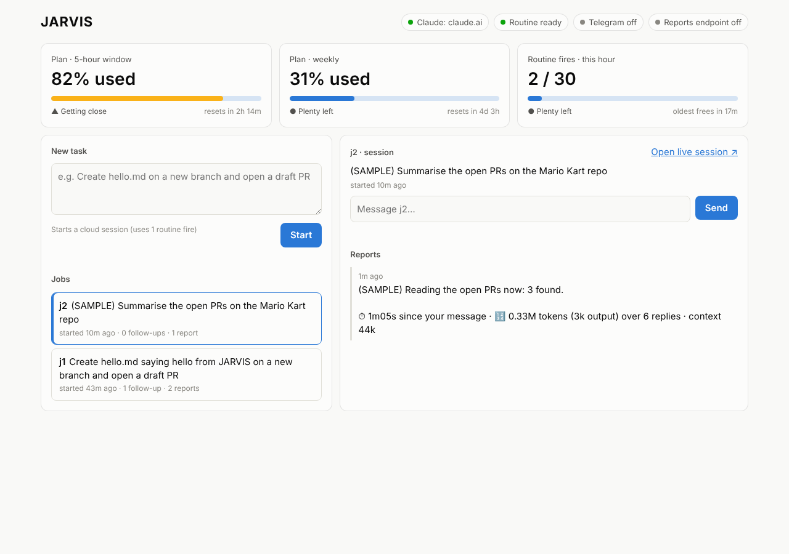

# JARVIS

A headless personal assistant that runs in Docker and drives **Claude Code cloud sessions**. You
give it a task from the **dashboard** (or Telegram), it starts a cloud session on it, you steer
that session with follow-up messages, and the session reports back with what it did, how long it
took and how many tokens it used.

You can also just **talk to JARVIS** in plain language ("what's mk up to?", "tell mk to pause after
MK-77", "summarise the Mario Kart PRD from Notion"). It answers using its tools: your sessions'
reports and history, sending messages, starting sessions, and reading Notion.

Everything runs on the Claude subscription. There's no API key: the container is a small Node app
plus the Claude Code CLI. The chat runs through `claude -p` on your login, and the coding work
happens in cloud sessions.



```
 Dashboard / Telegram ──► JARVIS container ──fire routine (HTTP)──────► new cloud session
                                  │         ──claude -p --cloud <id>──► existing cloud session
                                  │                                          │
 Telegram / dashboard ◄──────────── session runs scripts/report.sh ──────────┘
```

| Action | How | Docs |
|---|---|---|
| Start a session | Routines API trigger (`POST /v1/claude_code/routines/{id}/fire`) | [routines](https://code.claude.com/docs/en/routines) |
| Message a running session | `claude -p --cloud <session-id>` in the container | [follow-ups from the CLI](https://code.claude.com/docs/en/claude-code-on-the-web#send-follow-ups-from-the-cli) |
| Hear back | The session runs `scripts/report.sh` (Telegram and/or the dashboard) | [network access](https://code.claude.com/docs/en/cloud-environments) |

## Setup, in order

You need: Docker (Docker Desktop on a Mac), your Claude Max login, and Claude Code on the web
already connected to GitHub with access to this repo (claude.ai/code → it's the same connection
your orchestrators use).

### Part A: on claude.ai (about 10 minutes)

**A1. Make a cloud environment for JARVIS jobs.** At claude.ai/code, open the environment menu →
add an environment named `JARVIS`.
- Network access: **Trusted** is fine for now. If you'll use Telegram (Part C), pick **Custom**
  instead, keep the default allowlist, and add `api.telegram.org`.
- No environment variables yet.

**A2. Make the routine that starts sessions.** At claude.ai/code/routines → **New routine**:
- **Repository:** `MattSharp05/VirtualAssistant` (it clones `main`, which has `scripts/report.sh`).
- **Environment:** `JARVIS`.
- **Instructions:** paste everything below the line in [docs/routine-prompt.md](docs/routine-prompt.md).
- No schedule. Save it.

**A3. Give the routine an API trigger.** Open the routine → **Add another trigger** → **API** →
**Generate token**. Copy two things somewhere safe:
- The **token** (starts `sk-ant-oat01-`). It's shown only once; generating a new one revokes it.
- The **routine ID** (starts `trig_`). It's in the fire URL shown with the token:
  `…/routines/trig_XXXX/fire`.

### Part B: on your machine (about 5 minutes)

**B1. Get the code.**
```bash
git clone https://github.com/MattSharp05/VirtualAssistant.git
cd VirtualAssistant
```

**B2. Configure.**
```bash
cp .env.example .env
```
Open `.env` and fill in `ROUTINE_ID` and `ROUTINE_TOKEN` from A3. Leave the rest empty for now.

**B3. Build the image.**
```bash
docker compose build
```

**B4. Log the container's Claude Code in to your claude.ai account (once).**
```bash
docker compose run --rm jarvis claude auth login
```
Pick the Claude subscription when asked, open the link it prints, approve, and paste the code
back into the terminal. The login is saved on the `jarvis-data` volume, so rebuilds keep it.

**B5. Start JARVIS.**
```bash
docker compose up -d
```
Open **http://localhost:8080**. The chips at the top should say **Claude: claude.ai** and
**Routine ready**, and the two **Plan** tiles should show your 5-hour and weekly usage.

**B6. Check from the terminal (optional).**
```bash
docker compose exec jarvis npm run doctor
```

### First-win test (dashboard)

1. In **New task**, enter `Create hello.md saying hello from JARVIS on a new branch and open a draft PR`
   and click **Start**. You should see "Started j1 in …s", and the fire counter goes to 1/30.
2. Click **Open live session ↗** to watch it work on claude.ai.
3. Type a follow-up in the job's message box, e.g. `also add today's date to the file`, and click
   **Send**. You should see "Sent to j1 in …s", and the message should appear in the live session.

If step 3 works, the container can steer cloud sessions, which is the core of the whole project.

**Reports:** a cloud session can't reach `localhost`, so until you set up Part D (dashboard) or
Part C (Telegram) its reports stay in the session. Watch it with **Open live session**.

### Part C (optional): Telegram

1. Message **@BotFather** → `/newbot` → copy the token into `.env` as `TELEGRAM_BOT_TOKEN`.
2. `docker compose up -d`, then send `/start` to your bot. It replies with your chat ID.
3. Put the chat ID in `.env` as `TELEGRAM_ALLOWED_CHAT_ID`, and `docker compose up -d` again.
   Until this is set, the bot answers nobody but that `/start`.
4. In the `JARVIS` cloud environment: set network access to **Custom** (defaults + `api.telegram.org`)
   and add environment variables `TELEGRAM_BOT_TOKEN=<token>` and `TELEGRAM_CHAT_ID=<chat id>`.
   These are visible to anyone who can use the environment, which on a personal plan is just you.

Commands:
- `/sessions`: tap one of your cloud sessions; what you type next goes straight to it.
- `/jarvis`: go back to talking to JARVIS. This is the default; plain text goes to JARVIS.
- `/model`: pick the model JARVIS's chat uses.
- `/newchat`: start a fresh conversation with JARVIS.
- `/new <task>`, `/jobs`, `/use <job>`, `/say <job> <message>`, `/attach <link> <name>`,
  `/forget <job>`, `/status`.

### Part D: reports in the dashboard (Tailscale)

A cloud session can't reach `localhost` on your machine, so the Tailscale container gives JARVIS a
permanent address, `https://jarvis.<your-tailnet>.ts.net`, with two separate doors:

```
 Cloud session ──report──► https://jarvis.<tailnet>.ts.net       (Funnel: public, needs REPORT_SECRET,
                                        │                          accepts reports and nothing else)
                                        ▼
                              JARVIS container ──► dashboard
                                        ▲
 Your devices ─────────────► https://jarvis.<tailnet>.ts.net:8443 (Serve: private, your tailnet only)
```

It works the same on a laptop and on a VPS: no ports opened, no domain, no certificates to manage.
Moving to a VPS means copying the folder (with `.env`) and running `docker compose up -d`; the
address doesn't change. See [tailscale/README.md](tailscale/README.md) for what's exposed.

**In the Tailscale admin console** (sign up free at tailscale.com):
1. **DNS** page: check **MagicDNS** is on, then under **HTTPS Certificates** click **Enable HTTPS**.
2. **Access controls** page: in the **Funnel** section click **Add Funnel to policy**. If you only see
   the JSON editor, add this inside the top-level braces and save:
   ```json
   "nodeAttrs": [{ "target": ["autogroup:member"], "attr": ["funnel"] }],
   ```
3. **Settings → Keys**: **Generate auth key**. Leave Reusable and Ephemeral off, no tags. Copy the
   `tskey-auth-…` value.

**On your machine**, in `.env` (replace any existing empty lines with the same names):
```
COMPOSE_PROFILES=tailscale
TS_AUTHKEY=tskey-auth-…
TS_HOSTNAME=jarvis
REPORT_SECRET=<output of: openssl rand -hex 32>
```
Then `docker compose up -d --build`. Find your address with
`docker compose exec tailscale tailscale serve status`, and check the public door by opening
`https://jarvis.<tailnet>.ts.net` from any browser. It should say "JARVIS reports endpoint is
up." The first load can take a minute while the certificate is issued.

**In the Tailscale admin console → Machines:** on `jarvis`, open the menu and **Disable key expiry**,
or it drops off the tailnet after about 180 days.

**On claude.ai**, edit the `JARVIS` cloud environment:
- Network access **Custom**: tick **Also include default list of common package managers**, and put
  `jarvis.<tailnet>.ts.net` in **Allowed domains** (plus `api.telegram.org` if you use Telegram).
- Environment variables:
  ```
  JARVIS_REPORT_URL=https://jarvis.<tailnet>.ts.net
  JARVIS_REPORT_SECRET=<same value as REPORT_SECRET>
  ```

**Bonus:** install the Tailscale app on your phone, sign in with the same account, and open
`https://jarvis.<tailnet>.ts.net:8443` to use the dashboard from anywhere. Only your devices can.

### Part E: connect your orchestrators

JARVIS can message **any** cloud session, not only the ones it starts. There are three ways a
session gets onto the dashboard:

- **Pick it from your session list.** The dashboard's **Your cloud sessions** list (and `/sessions`
  in Telegram, as tap-to-select buttons) shows your active cloud sessions, newest first. Pick one
  and type: JARVIS tracks it under a name made from its title. The list comes from an
  **undocumented** source (`claude agents --json`, falling back to the endpoint the CLI's teleport
  picker uses), so if it ever says "not available", attaching by link still works. Check what
  JARVIS sees with `docker compose exec jarvis npm run -s sessions`.

- **Attach it by link.** Dashboard → **Add an existing session**: paste its `claude.ai/code/…`
  address and give it a short name (`mk`, `shapemint`). Telegram: `/attach <link> <name>`. You
  can message it straight away.
- **It reports in.** A session that runs the reporter (`scripts/report.sh` here, or
  `scripts/jarvis_report.sh` in the claude-workflow plugin) sends its own session ID with every
  report. JARVIS adds an unknown name automatically, and when a successor orchestrator takes
  over and reports under the same name, JARVIS moves the name to the new session. "mk" always
  means the current Mario Kart orchestrator.

For an orchestrator to report, its project's cloud environment needs the same settings as the
`JARVIS` environment in Part D: `jarvis.<tailnet>.ts.net` in **Allowed domains**, plus
`JARVIS_REPORT_URL` and `JARVIS_REPORT_SECRET` (and the Telegram pair if you use it). The
claude-workflow plugin's `run-batch` skill then reports batch starts, merges, blocks and handovers
on its own, under the project's ticket prefix (MK → `mk`).

Messages to attached and self-reporting sessions tell them to answer with the plugin's reporter, or
simply in their own session if they can't. **Forget** (on the dashboard, or `/forget <name>`) only
stops JARVIS tracking a session; the session itself keeps running.

### Part F: talk to JARVIS (and Notion)

Nothing to set up for the chat itself: it uses the same Claude login as follow-ups (B4). Type in
**Talk to JARVIS** on the dashboard, or send plain text to the bot.

- **What it can do without asking:** read and summarise (reports, session history, Notion,
  Calendar, Gmail, Slack), send
  a message to a session, start a new session. It can't run commands or touch files in the
  container: its only tools are JARVIS's own.
- **Model:** the dropdown on the dashboard or `/model` in Telegram. The choices come from
  `BRAIN_MODELS` in `.env` (first one is the default, or set `BRAIN_MODEL`). A cheaper model is
  fine for status questions.
- **Conversation:** it remembers the conversation across messages, on both the dashboard and Telegram.
  "new conversation" or `/newchat` starts over, which also keeps each reply cheaper.
- **Streaming:** replies appear as they're written: on Telegram the message shows after the first
  sentence and grows (the metrics line is added at the end); on the dashboard the bubble grows. One
  chat process stays running between messages (`BRAIN_WARM=0` turns that off).
- **Metrics** under every reply: `⏱ 4.2s · 🔢 18k in (16k cached) · 212 out · sonnet · 3 steps`.
  Steps are model turns; each tool call adds one. The dashboard shows running totals.

**Connect Notion:**
1. Go to [notion.so/my-integrations](https://www.notion.so/my-integrations) → **New integration**.
   Name it `JARVIS`, pick your workspace, type **Internal**, then **Save**.
2. On the integration's **Configuration** tab, under **Capabilities**, tick **Read content**,
   **Insert content** and **Update content**, then **Save**. Copy the **Internal Integration Secret**.
   (JARVIS only ever writes to the two places step 6 creates; everything else stays read-only.)
3. Paste it into `.env` as `NOTION_TOKEN=` (in your editor; don't paste it into chats).
4. Share pages with it. JARVIS sees only what you share. Open a top-level page (for example your
   projects page) → **•••** (top right) → **Connections** → **Connect to** → `JARVIS`. Child
   pages and databases under it are included.
5. `docker compose up -d`. The dashboard's **Notion** chip turns green with the number of pages it can see
   (`/status` in Telegram says the same). "token rejected" means a wrong secret; "0 pages" means
   nothing is shared with it yet.
6. Create JARVIS's own space in Notion (your to-do list and what it remembers about you). Pick a
   page shared with the integration (e.g. your "JARVIS" page), copy its link, then run:
   `docker compose exec jarvis npm run setup:notion -- --parent <page link>`.
   It adds **JARVIS Tasks** (a database) and **JARVIS Memory** (a page) under it, once; running it
   again changes nothing. Then try "remind me to renew my passport on Friday".

**Google Calendar, Gmail and Slack (read-only), through your claude.ai connectors:**
1. On claude.ai: click your name (bottom left) → **Settings** → **Connectors**. Click **Connect**
   on **Google Calendar**, **Gmail** and **Slack**, then sign in and click **Allow**.
2. Check the container sees them: `docker compose exec jarvis claude mcp list` should show them
   as `✔ Connected`.
3. That's it. Ask "what's on today?", "anything important in my inbox?" or "what did I miss on Slack?".
   JARVIS can only use the reading tools: sending, replying, trashing, labelling, creating or
   changing events, and posting or reacting on Slack are blocked (`CONNECTORS` in `src/brain.ts`). `BRAIN_CONNECTORS` in `.env` picks which
   connectors it uses (default `Google Calendar,Gmail,Slack`; `none` turns them off).

## Metrics

| Metric | Where | How it's measured |
|---|---|---|
| **Plan usage** (5-hour and weekly) | Dashboard tiles, `/status` | Asked from the CLI every minute; amber from 75%, red from 90% |
| Routine fires used | Dashboard tile, `/status` | Container: timestamps of each new task |
| Time to start a session | "Started j1 in 1.4s" | Container: the routine API call |
| Time to deliver a follow-up | "Sent to j1 in 2.1s" | Container: the `claude -p --cloud` call |
| **Time taken per response** | Report footer: `⏱ 4m12s since your message` | Session: now minus the send time JARVIS stamped on the message |
| **JARVIS chat: time, tokens, steps** | Under each reply | The CLI's own result (`duration_ms`, `usage`, `num_turns`) |
| **Tokens** | Report footer: `🔢 1.84M tokens (31k output) over 22 replies · context 85k` | Session: its own transcript, counted like claude-workflow's `session_tokens.py` |

How to read the token numbers:
- **The total is mostly cache re-reads.** Every reply re-reads the whole conversation, so the total
  grows much faster than the output.
- **`context`** is the size of the latest reply's context. Every next reply re-reads that much, so
  a large context means each step costs more.

**Plan usage is read through an undocumented request.** The CLI answers a `get_usage` control
request (the same one backtalk uses), but no public API covers it. It makes no model call. If
Anthropic changes it, the tiles say "not available" and nothing else breaks.

## Limits to know

- **Routines: 30 fires per hour per routine, and 100 per hour per account.** A "fire" is one API
  call that starts one new session, so only a new task uses one; follow-ups and reports don't.
  "Run now" on the website counts too. The hour rolls: each fire frees up 60 minutes after it
  happened. JARVIS counts its own fires and refuses a 31st with the time the next slot frees,
  rather than letting the API return 429.
- **The subscription allowance is shared.** JARVIS jobs, your orchestrators and builders all draw
  from the same Max plan, with a rolling 5-hour window and a weekly cap; the Plan tiles show both.
  When the window runs out, every session stops until it resets. The container uses nothing while
  idle.
- **Idle sessions get paused.** A cloud session's VM is reclaimed after a period of inactivity.
  The conversation is kept, but background work in it is lost. Archived sessions reject new messages.
- **Size caps:** a routine fire's text is capped at 65,536 characters, and a Telegram message at
  4,096. `report.sh` trims to 4,000.
- **Session lists and history use undocumented endpoints.** They're the same ones the CLI uses
  for `claude agents` and teleport. If they change, the list falls back to tracked sessions,
  and "what is X doing" falls back to that session's reports.
- **Chat uses the plan too.** Every JARVIS reply draws on the same allowance; long conversations
  re-read more each time, so start a new one now and then.

## Troubleshooting

| Symptom | Fix |
|---|---|
| "Claude: not signed in", or sends fail with "needs a claude.ai sign-in" | Run B4 again. Don't set `CLAUDE_CODE_OAUTH_TOKEN` or `ANTHROPIC_API_KEY` in `.env`: they override the login and can't drive cloud sessions. |
| Start fails with HTTP 401/403 | `ROUTINE_TOKEN` is wrong or was regenerated. Copy the current one. |
| Start fails with HTTP 404 | `ROUTINE_ID` is wrong. Take it from the fire URL. |
| Session starts but never reports on Telegram | Check the `JARVIS` environment: Custom allowlist includes `api.telegram.org`, and both Telegram variables are set. |
| JARVIS says Notion isn't connected | `NOTION_TOKEN` is missing; see Part F. "Not found" for a page means it isn't shared with the integration. |
| Plan tiles say "not available" | The login isn't a claude.ai subscription login, or the undocumented request changed. Everything else still works. |

## JARVIS Desk (Mac app)

JARVIS Desk is the Mac app: an orb on top of your screen that listens and speaks, plus windows for
chat, sessions, today, calendar, to-dos and Notion. Install it from the
[Releases page](https://github.com/MattSharp05/VirtualAssistant/releases): see
[docs/desk-install.md](docs/desk-install.md). To publish a new version: push a tag `desk-vX.Y.Z`, or run **Actions → Release JARVIS Desk → Run workflow** with a version.

## Development

The repo is an npm workspace: the server at the root, `shared/` (types used by the server and the
Desk app) and `desk/` (JARVIS Desk, the Electron app).

```bash
npm install                      # in cloud sessions: ELECTRON_SKIP_BINARY_DOWNLOAD=1 npm install
npm test                         # server: typecheck + unit tests (fake claude binary, no network)
npm run check                    # everything: server tests + desk lint, typecheck, tests, build
npm run -w @jarvis/desk lint     # ESLint + Prettier for the Desk app (format: npm run -w @jarvis/desk format)
npm run -w @jarvis/desk test     # Desk unit tests (Vitest)
npm run -w @jarvis/desk build    # main + preload (esbuild) and renderer (Vite)
npm run -w @jarvis/desk dev      # renderer in a browser with hot reload
npm run -w @jarvis/desk start    # build and launch the app (needs the Electron binary, i.e. a Mac)
```

Layout: `src/jarvis.ts` (what JARVIS can do), `src/web.ts` + `public/index.html` (dashboard),
`src/bot.ts` (Telegram), `src/routines.ts` (fire API), `src/cloud.ts` (CLI wrapper),
`src/usage.ts` (plan usage), `src/store.ts` (jobs, reports and fires on the volume), `scripts/`
(runs inside cloud sessions).
